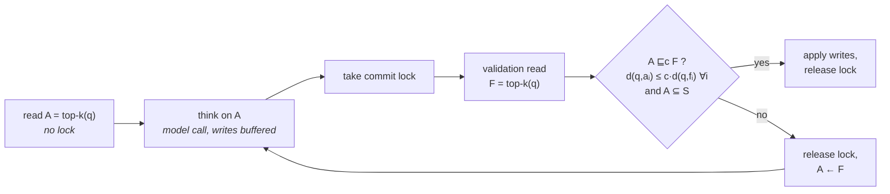

<h1 align="center">Ariadne</h1>

<p align="center">
  <b>Admissible, Not Repeatable: Isolating Approximate Similarity Reads in Shared Agent Memory</b><br>
  Code, experiments and paper sources of the PVLDB Vol. 20 paper<br>
  <a href="ariadne-full-version.pdf">Full version with appendices (PDF)</a>
</p>

<p align="center">
  
  
  
  
  
</p>

<p align="center">
  <a href="#overview">Overview</a> ·
  <a href="#installation">Installation</a> ·
  <a href="#quick-start">Quick start</a> ·
  <a href="#running-the-experiments">Experiments</a> ·
  <a href="#postgresql-findings">PostgreSQL</a> ·
  <a href="#reproducing-the-paper">Reproducing the paper</a> ·
  <a href="#citation">Citation</a>
</p>

---

## Overview

Agents that share a vector store as memory record an observation with a short transaction: an approximate
similarity search, a model call that takes seconds, and a write. Two agents can read the same neighborhood a
second apart, both decide that an observation is new, and store it twice. No isolation level says what such a
read may return while other agents write, and the existing options either let the race through (the default of
vector stores), lock far too much and still miss conflicts (serializable PostgreSQL with pgvector), or repeat the
model call whenever a re-read at commit differs at all (re-execution validation).

Ariadne starts from the observation that an approximate read never promised the exact answer, so isolation need
not protect it either. The paper makes this precise and builds a system on it:

| | |
|---|---|
| **c-admissible answer** | a top-k answer whose i-th item is within c times the distance of the i-th exact neighbor, for every rank i |
| **c-serializability** | some serial order explains every answer an agent acted on as c-admissible in the state just before it |
| **Admissibility validation (Algorithm AV)** | optimistic concurrency control whose commit test is the per-rank distance test, the most permissive sound test |
| **Characterization** | a single concurrent write breaks admissibility only by landing closer to the query than 1/c of a retrieved item's distance |
| **Conflict law and lag kernel** | how often concurrent writes invalidate a read, from sibling writes (same topic) and background writes (unrelated) |
| **Auditor** | replays the commit log against exact search and separates what the index missed from what isolation let through |

Ariadne is a Python layer between agents and an **unmodified** store. It uses only the store's similarity search,
its writes and a lock, and runs unchanged on pgvector, Qdrant, Chroma, Milvus Lite, LanceDB, Weaviate and FAISS.



A transaction commits only if the answer it reasoned about is still c-admissible relative to the fresh answer;
otherwise it thinks again on the fresh answer, with no extra read, and aborts after 30 failed rounds. With an exact
validation read (the *certified* variant) every execution is c-serializable; with an index read the guarantee
composes multiplicatively with the index's own approximation ratio (Theorem 4.3 of the paper).

## Repository layout

```text
ariadne/                    the framework
├── policies.py             validation predicates: none, exact, set, overlap, top1, topj, radius, rank1, sumdist,
│                           cadm (ours), cert (certified), objects, oracle, redecide
├── metrics.py              admissibility test, approximation ratio, decision proxies
├── engine.py               protocol runner: none, validate (Algorithm AV), compensate, lock_long, ball, ssi
├── workloads.py            stream, fan-out, cluster and synthetic workloads; teams, think times, arrivals
├── deciders.py             threshold rule and LLM decider (ADD / UPDATE / DELETE / NOOP)
├── stores/                 adapters: pgvector, qdrant, chroma, milvus, lancedb, weaviate, faissmem
├── audit.py                offline auditor (run, first, sep, serial, law, replay)
├── selftest.py             fault injection into run logs: does the auditor catch broken protocols?
├── law.py                  conflict law: closed forms, Monte Carlo, fits, transfers, lag kernel, strata
├── static_kernel.py        lag kernel estimated from a static stream, before any concurrent run
├── qa.py                   downstream question answering on the memory a run produced
├── micro.py                store-free microbenchmarks (predicate cost, audit cost)
├── data.py                 data set loaders and embedders (prep, stats)
├── provenance.py           code and data fingerprints recorded with every result
├── pgtests/                PostgreSQL SERIALIZABLE probes (locks, hole, hammer, generic, gist, keyed, antipodal, patched)
├── ext/                    the race through an agent-memory framework (Mem0) and an offline OpenAI-compatible mock
├── plots/                  every figure and generated table of the paper
└── tools/                  helpers to redraw single figures
experiments/                60 experiment files (A1 to G3), the single runner and data preparation
├── run.py                  python experiments/run.py experiments/<ID>.yaml [--smoke] [--only k=v] [--set k=v]
├── prepare_data.sh         prepares every data set from the public raw files
├── _plan.py                regenerates EXPERIMENTS.md from the experiment files
└── vldb/                   the scripts of the reported runs (machine setup, timing runs, model runs, environment)
examples/quickstart.py      the race and Algorithm AV in about a hundred lines, no data needed
patches/                    pgvector_ssi_recheck.patch (closes the SERIALIZABLE window of pgvector's HNSW)
paper/                      LaTeX sources; every number, figure and table is generated from the results
EXPERIMENTS.md              the experiment catalogue (generated)
ariadne-full-version.pdf    full version of the paper: proofs, PostgreSQL details, conflict law, further experiments
```

## Installation

Python 3.11 or newer (the reported runs used Python 3.13).

```bash
git clone https://github.com/anonymous-ai-researcher/ariadne.git
cd ariadne
python -m venv .venv && source .venv/bin/activate
pip install -r requirements.txt
```

`requirements.txt` separates the core (NumPy, SciPy, FAISS, PyYAML, Matplotlib, psycopg2, requests) from the
optional packages needed by single stores or features (Chroma, Milvus Lite, LanceDB, Weaviate, WordLlama,
sentence-transformers, OpenAI, Mem0, h5py). Install only what the experiments you run need.

<details>
<summary><b>PostgreSQL with pgvector</b> (pgvector store, SERIALIZABLE experiments, <code>ariadne.pgtests</code>)</summary>

The reported runs use PostgreSQL 16.15 and pgvector 0.8.7 built from source:

```bash
sudo apt-get install -y postgresql-16 postgresql-server-dev-16 build-essential git gdb
git clone --branch v0.8.7 https://github.com/pgvector/pgvector.git
make -C pgvector && sudo make -C pgvector install
sudo -u postgres createuser -s "$USER" && createdb root     # the default DSN is "dbname=root"
export PG_DSN="dbname=root"                                  # or any libpq connection string
```

The debugger-based tests (`hole`, `generic`) need gdb and ptrace permission
(`sysctl -w kernel.yama.ptrace_scope=0`). The full machine setup of the reported runs, including the PostgreSQL
settings, is `experiments/vldb/setup_perf_machine.sh`.
</details>

<details>
<summary><b>Other stores</b></summary>

| Store | Mode | Setup |
|---|---|---|
| FAISS (`faissmem`) | in process | `faiss-cpu`; also the exact reference (`index: flat`) |
| Chroma | in process | `chromadb` |
| Milvus Lite | in process | `pip install "pymilvus[milvus_lite]"` |
| LanceDB | in process | `lancedb` |
| Qdrant | server binary 1.15.4 | `export QDRANT_BIN=/path/to/qdrant` |
| Weaviate | Docker image | `export WEAVIATE_HOST=localhost` |
| pgvector | PostgreSQL | see above |

`experiments/vldb/setup_stores.sh` installs Qdrant and Weaviate and prints the two exports.
</details>

## Data

The repository contains no data. All data sets are public; download the raw files into `data/raw/` and prepare
them once:

```bash
RAW=data/raw EMB_SPEC=wordllama bash experiments/prepare_data.sh
```

| Data set | Raw file | Role in the experiments |
|---|---|---|
| [LoCoMo](https://github.com/snap-research/locomo) | `locomo10.json` | conversational memory: turns are the initial memory, extracted facts the write stream, one team per conversation |
| AG News | `train.csv` | news stream in natural order; neighboring items often report the same event |
| LongMemEval | `longmemeval_s.json` | haystack sessions of a long-term memory benchmark |
| Quora Question Pairs | `quora_duplicate_questions.tsv` | real clusters of duplicate questions |
| MS MARCO passages | `collection.tsv` | initial memory with 10^6 items |
| spaCy `en_core_web_md` | the wheel file | point cloud of the synthetic paraphrase fan-out workload |

Each prepared data set is `data/<name>__<embedder>.npz` (unit-normalized embeddings, role, group and label arrays)
plus `data/<name>.texts.jsonl` for the language-model decider. The embedder is `wordllama` (static, 256
dimensions, used for the reported runs), `st:<sentence-transformers model>` or `openai:<model>`; experiment files
select prepared data through `EMB`. After changing the embedder, choose the duplicate threshold again with
`python -m ariadne.data stats --npz data/<file>.npz`. Synthetic workloads need no data at all.

## Quick start

**The race and the fix, in a few seconds and without any data.** Several agents run check-then-insert on one
in-process FAISS store; the script compares no isolation, re-execution and admissibility validation:

```bash
python examples/quickstart.py
```

```text
8 agents, 40 facts x 3 reports, k=10, tau=0.3, think=0.05s
policy      stored  duplicates  model calls  extra calls  wall s
none            47           7          120            0    0.77
exact           40           0          129            9    0.87
cadm:1.1        40           0          126            6    0.83
```

The numbers of this toy depend on timing and differ from run to run; the experiments below measure the effect.

**The commit test on its own.** A policy decides whether a held answer `A` may commit given the fresh answer `F`;
answers are lists of `(item_id, distance)` sorted by distance:

```python
from ariadne.policies import Policy

held  = [(17, .81), (4, .87), (9, .87), (2, .88), (31, .90), (8, .90), (5, .91), (40, .91), (12, .92), (6, .93)]
fresh = [(99, .52)] + held[:9]        # a near duplicate of the query was inserted at rank 1
far   = held[:7] + [(77, 1.02)] + held[7:9]   # an unrelated item entered at rank 8

Policy("exact", 10).valid(held, far)        # False: re-execution pays for any change
Policy("cadm:1.1", 10).valid(held, far)     # True:  the held answer is still 1.1-admissible
Policy("overlap:0.9", 10).valid(held, fresh)  # True:  identity tolerance misses the duplicate
Policy("cadm:1.1", 10).valid(held, fresh)   # False: the per-rank test catches it
```

**A smoke run of a real experiment** (synthetic workload, in-process store, no data, under a minute):

```bash
python experiments/run.py experiments/B2_separation.yaml --smoke --out results
python -m ariadne.plots.fig_s_25_separation --results results --suffix _smoke --out figures
```

## Running the experiments

Every experiment is one YAML file that states its question, its grid, the protocols it compares and the audits
that run on its logs. All of them go through one runner:

```bash
python experiments/run.py experiments/C1_calls_vs_policy.yaml                     # full grid
python experiments/run.py experiments/C1_calls_vs_policy.yaml --smoke             # small version (minutes)
python experiments/run.py experiments/C1_calls_vs_policy.yaml --dry-run           # list the cells
python experiments/run.py experiments/C1_calls_vs_policy.yaml --only case=A64 --only protocol.policy=cadm:1.1
python experiments/run.py experiments/C1_calls_vs_policy.yaml --repeat 8 --only case=A64   # seeds 1..8
python experiments/run.py experiments/A5_ssi_cost.yaml --set store.dsn="dbname=bench host=db1"
python experiments/run.py --all --smoke                                           # smoke run of everything
```

Results go to `results/<experiment>/`: one `summary.jsonl` row per cell, one `audit_<kind>.jsonl` row per audit,
the per-task logs (`<cell>.pkl`, `<cell>.audit.npz`) and `journal.jsonl` with the provenance of every cell. Cells
that already have results are skipped, so an interrupted run can be restarted; `--force` recomputes them.
`EXPERIMENTS.md` lists all 60 experiments with their questions, grids, sizes and commands.

| Group | Question | Experiments | Paper |
|---|---|---|---|
| **A** Anomalies on real systems | the race on seven stores; cost and soundness of SERIALIZABLE; application-level remedies; Mem0 | A1 to A11 | §3, App. B, D.1 |
| **B** Correctness | safety theorem, separation, multi-read transactions, deletions, broken protocols, characterization | B1 to B7 | §4, App. A, D.2, E |
| **C** Savings and cost | model calls per predicate, trade-off frontier, language-model decisions, downstream QA, latency and throughput, pessimistic locking | C1 to C13 | §6.2 to §6.4, §6.6, App. D.3, D.4 |
| **D** Conflict theory | closed form, planted law, real streams, exchangeable controls, heterogeneous dimension, embedders | D1 to D6b | §5, §6.5, App. C |
| **E** Ablations | predicate components, lock scope, retry strategy, validation budget, isolation of phases, per-decision tolerance | E1 to E6 | §6.7, App. D.5 |
| **F** Robustness | stores, embedders and data sets, seeds, processes, long runs, failure injection, L2 metric | F1 to F7 | §6.7, App. D.5 |
| **G** Microbenchmarks | critical-section breakdown, uncontended overhead, predicate and audit cost | G1 to G3 | §4.3, App. D.4 |

<details>
<summary><b>Environment variables used by the experiment files</b></summary>

| Variable | Meaning | Default |
|---|---|---|
| `EMB` | embedder tag of the prepared data | `wordllama` |
| `PG_DSN` | libpq connection string of the PostgreSQL server | `dbname=root` |
| `QDRANT_BIN`, `QDRANT_URL` | Qdrant server binary or address | |
| `WEAVIATE_HOST` | Weaviate host | |
| `WORK` | scratch directory of embedded stores | `work` |
| `LLM_MODEL`, `OPENAI_BASE_URL`, `OPENAI_API_KEY` | language-model endpoint (OpenAI or any compatible server, such as vLLM) | |
| `EMBED_MODEL` | embedding model of the Mem0 experiment (A9) | |
| `LOCOMO_RAW` | raw LoCoMo file for the downstream QA experiment (C4) | |
| `ARIADNE_PG_DSN`, `ARIADNE_PG_TMP` | DSN and handshake directory of `ariadne.pgtests` | |
</details>

### The reported runs

`experiments/vldb/` holds the scripts of the runs reported in the paper, which ran on dedicated servers
(Appendix F of the [full version](ariadne-full-version.pdf) describes the machines):

```bash
sudo bash experiments/vldb/setup_perf_machine.sh     # once: PostgreSQL 16.15, pgvector 0.8.7, fixed CPU frequency
bash experiments/vldb/setup_stores.sh                # once: Qdrant and Weaviate
bash experiments/vldb/run_perf.sh                    # every experiment that reports a time or a rate, then the count experiments
bash experiments/vldb/run_llm.sh gpt4omini           # C3, C4 and A9 with GPT-4o mini
bash experiments/vldb/setup_gpu.sh                   # on the GPU host: vLLM serving Qwen2.5-7B-Instruct
bash experiments/vldb/run_llm.sh qwen7b              # C3 and C4 with Qwen2.5-7B-Instruct
```

Each script first calls `record_env.sh`, which stores the hardware, kernel, PostgreSQL, pgvector, Python package
and model versions in `<results>/ENV/`.

## Auditing

The auditor needs neither the store nor the index: it rebuilds the exact state at any commit-log position from
the workload and the log, and recomputes all distances from the vectors.

```bash
python -m ariadne.audit run    results/C1_calls_vs_policy/<cell>.pkl   # ratios, contract violations, safety-theorem check
python -m ariadne.audit sep    results/B2_separation/<cell>.pkl        # pairwise separation of the final store
python -m ariadne.audit serial results/A11_simple_baselines/<cell>.pkl # differences from a serial exact execution
python -m ariadne.audit first  results/C2_counterfactual_pareto/<cell>.pkl  # every predicate replayed offline
python -m ariadne.selftest     results/B1_safety_theorem/<cell>.pkl    # plant faults, check that they are caught
```

`experiments/run.py` runs the audits named in each experiment file automatically.

## PostgreSQL findings

`ariadne.pgtests` reproduces the findings of §3.2 on a stock installation; every module runs with
`python -m ariadne.pgtests.<name>` and accepts `--dsn`, `--trials`, `--out` and `--smoke`.

| Module | What it shows |
|---|---|
| `locks` | a serializable similarity read takes a relation-level SIREAD lock on the whole HNSW or IVFFlat index |
| `antipodal` | two transactions whose queries are almost antipodal still abort each other (B-tree control commits both) |
| `hole` | with a debugger pause inside `hnswinsert`, two check-then-insert transactions both commit a duplicate |
| `hammer` | the same window without a debugger, as a function of insertion time (`m`, `ef_construction`), with controls |
| `generic` | the same window on SP-GiST and BRIN; B-tree as the negative control |
| `gist` | GiST, which does take predicate locks, misses a conflict when an insertion only enlarges a bounding box |
| `keyed` | the same transaction on a scalar key with a B-tree, for comparison of abort rates |
| `patched` | builds pgvector with `patches/pgvector_ssi_recheck.patch` and repeats the tests against it |

The window exists because `index_insert()` checks for serializable conflicts before `hnswinsert()` links the new
element. The patch repeats the check right after the element is linked:

```bash
git -C pgvector apply ../patches/pgvector_ssi_recheck.patch && make -C pgvector && sudo make -C pgvector install
```

The issue is reported upstream as [pgvector#1055](https://github.com/pgvector/pgvector/issues/1055).
`python -m ariadne.pgtests.patched` prints the build, install and restore steps used for the reported runs.

## Conflict law

```bash
python -m ariadne.law mc --out mc.json                                   # closed form against Monte Carlo
python -m ariadne.law fit results/D3a_law_real/*.law.pkl --out fits.json # fit and test on real streams
python -m ariadne.law transfer --src L4.law.pkl --dst L8.law.pkl --mode window   # predict without refitting
python -m ariadne.law lag results/D3a_law_real/*.law.pkl                 # lag kernel
python -m ariadne.static_kernel --law L4.law.pkl --predict L8.law.pkl --out kernel.json   # from the static stream
```

Law files (`<run>.law.pkl`) are written by the `law` audit of the D experiments. Only insertion positions are
used in a fit; ranks and conflict outcomes are kept for testing.

## Reproducing the paper

Every measured number in the two LaTeX files is a macro (`\res[shape]{key}`) that `paper/make_results.py` resolves
from the result files through the key map in `paper/resmap/`; figures and generated tables come from
`ariadne.plots`. Nothing measured is typed by hand.

```bash
python paper/assemble_results.py --vm <base results> --perf results_vldb_perf \
       --gpt results_vldb_gpt4omini --qwen results_vldb_qwen7b --out results_vldb_merged
RESULTS=results_vldb_merged bash paper/build.sh            # draft: missing values print their shape
FINAL=1 RESULTS=results_vldb_merged bash paper/build.sh    # final: anything missing is a compile error
```

`paper/build.sh` writes `paper/pvldb20-ariadne.pdf` (main text) and `paper/pvldb20-ariadne-full.pdf` (full version
with appendices), and `paper/results_report.md` with the value, the number of runs and the provenance of every
key. `python paper/make_results.py --list` lists all keys; `--context <prefix>` shows where a key is used in the
text. See `paper/README.md`.

## Provenance

Every result row carries the fingerprint of the code that produced it and of the data it read:

```bash
python -m ariadne.provenance code       # sha256 over ariadne/**/*.py, the experiment files, run.py, prepare_data.sh and patches/
```

The fingerprint is stored in `summary["provenance"]` of every cell and in `results/<experiment>/journal.jsonl`,
together with the sha256 of every embedding array the cell read, the package versions and the host.

## Extending Ariadne

- **A store**: subclass `Store` and `Session` in `ariadne/stores/base.py` (search, exact search, insert, delete,
  exists, lock) and register it in `make_store`. Stores without transactions get the commit lock from the adapter;
  `lock: file:<path>` selects an inter-process lock.
- **A validation predicate**: add a branch to `Policy.valid` in `ariadne/policies.py`; it is then available as a
  `protocol.policy` value in every experiment file.
- **A memory framework**: `ariadne/ext/README.md` describes the three methods an adapter needs and how the
  adapters for LangMem, Letta, Zep, A-MEM and MemoryOS would map.
- **An experiment**: copy a YAML file in `experiments/`, then run `python experiments/_plan.py` to update the catalogue.

## Citation

```bibtex
@article{lu2027ariadne,
  author  = {Chang Lu and Yizheng Zhao},
  title   = {Admissible, Not Repeatable: Isolating Approximate Similarity Reads in Shared Agent Memory},
  journal = {Proceedings of the VLDB Endowment},
  volume  = {20},
  year    = {2027}
}
```

## License

Released under the [MIT License](LICENSE). The data sets keep their own licenses; `paper/acmart.cls`, `paper/pvldb.sty`
and `paper/ACM-Reference-Format.bst` are the publisher's templates and keep theirs.
